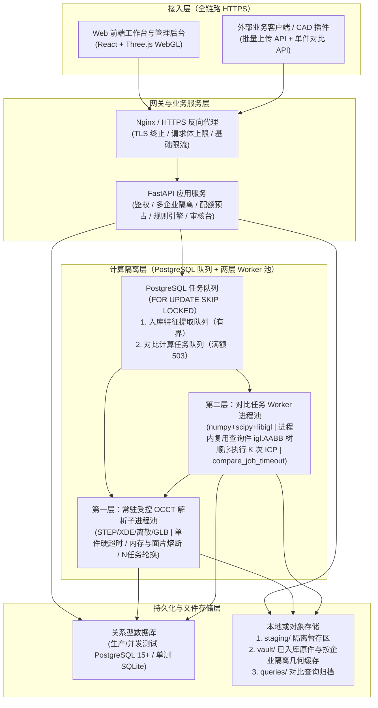
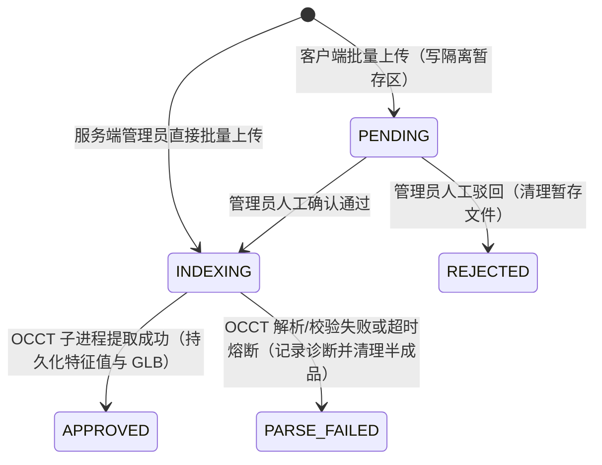

# STEP 模型相似度对比与检索系统 · 详细开发设计文档

**文档版本**：v1.1（工程开发基线，已合入 `STEP-SIM-005` 采纳修正）  
**编制日期**：2026-11-27  
**依据决定**：`STEP-SIM-004` + `STEP-SIM-005`（均已 ADOPTED，见 [PlanDocs/DECISIONS.md](../PlanDocs/DECISIONS.md)）  
**配套材料**：[相似度评判逻辑与标准说明](STEP模型相似度评判逻辑与判断标准说明.md) · [系统开发报价单（¥266,340 / 92人天）](STEP模型相似度对比与检索系统开发报价单.xlsx) · [详细开发计划](STEP模型相似度对比与检索系统详细开发计划.md)  
**收口实现补充**：鉴权短时内存缓存须使用有界 LRU/TTL 容器（如 `maxsize=10000`）；`feature_version` 后台重提取切换 `active_feature_version` 前须执行一次窗口期内新入库模型的增量查漏补齐。

> **工程定位与安全边界**：本系统用于多企业环境下的 STEP（`.stp`/`.step`）三维零件相似度量化计算、候选检索排序、图形化差异对比及客户端接口服务。相似度分数仅作检索、排序与差异辅助检查，**不单独等同于工程直接替代放行结论**；Web 工作台须固定展示该工程边界提示。

---

## 一、系统建设目标、复用基线与明确不做

### 1.1 建设范围与客户需求映射

本系统完整落地客户 2026-11-23 原始需求（[客户需求截图_20261123.jpg](客户需求截图_20261123.jpg)）与 `STEP-SIM-004` 采纳口径：

| 模块 | 对应报价工时 | 核心交付范围 |
| --- | :---: | --- |
| **模块一：多维度相似度评判引擎与规则配置模块** | 37 人/天 | 独立 OCCT Worker 子进程（超时/内存/面片熔断）、`D1–D7` 全维度特征提取与持久化、24 初值右手系刚体对齐与双向表面偏差、安全门禁（防镜像/对称歧义）、动态百分比与缺项规则引擎、有效权重上界剪枝 |
| **模块二：用户权限体系与服务端模型库管理模块** | 31 人/天 | 用户注册登录、企业与邀请码绑定、无邀请码 5 次并发安全限额、跨企业 SQL 强隔离与管理员全可见、五态待审入库状态机、6 项必记台账字段、同企重复 MD5 幂等去重、服务端规则配置与管理后台 |
| **模块三：图形化对比检查与客户端接口服务模块** | 24 人/天 | Three.js 联动并排/双色叠加对比工作台、分项误差与有效权重详情、工程边界提示、选中次数回写、客户端批量上传 API（防刷待审）与单件 STP 对比 API、接口安全限流与联调文档 |

### 1.2 从 `Demo/` 复用的已验证基线

工作区 `Demo/src/`（Windows Studio 0.3.1）已完成以下可复用内核验证，正式平台在独立目录中重构封装并升级，**不破坏 `Demo/` 原有演示代码**：

- **几何与对齐内核**：`Demo/src/geometry.py`（OCCT 读取与毫米尺度统一、B-Rep 面积/体积/主轴 OBB、三角离散与 GLB 导出）、`Demo/src/alignment.py`（24 组右手系刚体初值、Trimmed ICP、点到面最小二乘 + 点到点 SVD 回退、AABB 树双向距离采样、去重容差与歧义分流）；
- **场景叠加矩阵**：沿用经 `STEP-SIM-003` 验证的列向量换算公式 $M_{\text{scene}} = C_{\text{新}} \cdot T \cdot C_{\text{旧}}^{-1}$；
- **前端三维查看器**：参考 `Demo/src/web/app.js` 的 Three.js 双视口同步旋转缩放与双色半透明叠加交互。

### 1.3 明确不做（首期范围边界）

- 不做自动工程替代放行与合规签批（不替代 `STEP-SIM-002` 的工程替代需求单与盲测签批流程）；
- 不做中性 STEP 到原生 CAD 参数化特征树/草图表达式的逆向重建；
- 不做 ERP/PDM/PLM/MES/AD 域单点登录等未约定的外部系统深度双向对接；
- 不做大型整机装配体自动拆件配准与深度学习模型训练平台。

---

## 二、总体技术架构与工程目录规划

### 2.1 系统逻辑架构



### 2.2 推荐技术栈

| 分层 | 推荐选型 | 选型依据 |
| --- | --- | --- |
| 后端框架 | Python 3.11+ / FastAPI / Uvicorn + Pydantic v2 | 与 `Demo/` 现有 OCCT Python 绑定（`cadquery-ocp-novtk`，导入名 `OCP`）无缝衔接，自动生成 OpenAPI 接口文档，适合同步/异步任务编排 |
| 几何与对齐内核 | `cadquery-ocp-novtk`（`Demo/.venv` 实装 8.0.1.1.0，导入名 `OCP`；注意不是 `pythonocc-core`）+ `numpy` + `scipy`（`Rotation`）+ `libigl`（导入名 `igl`，注意不是 `trimesh`） | 仓库 `Demo/src/geometry.py` 与 `alignment.py` 已验证：`OCP` 负责 STEP/XDE/曲面与网格离散，`numpy+scipy+libigl` 负责 24 初值 ICP 与 `igl.AABB` 双向距离采样 |
| 数据库与 ORM | PostgreSQL 15+（仅非并发基础单测兼容 SQLite）+ SQLAlchemy 2.0 + Alembic | 支持行级锁（`SELECT ... FOR UPDATE` / `SKIP LOCKED`）与 `JSONB`。SQLite 不支持 `FOR UPDATE`、`SKIP LOCKED`、`GREATEST` 等语法，**任务队列、配额并发与行锁测试必须在 PostgreSQL 上执行** |
| 任务队列与两层进程隔离 | PostgreSQL 任务表（`FOR UPDATE SKIP LOCKED`）+ 常驻受控 OCCT 解析子进程池 + 对比任务 Worker 进程池（首期不引入 Redis / Celery） | 单人开发零额外中间件运维；OCCT 解析子进程隔离 C++ 崩溃与内存泄漏，对比 Worker 进程内复用 `igl.AABB` 树完成至多 $K$ 次 ICP，受 `compare_job_timeout` 硬超时管控 |
| 密码与鉴权 | `argon2-cffi` + JWT（短期 Access Token）+ 带 `HMAC-SHA256(pepper, uid:auth_version:pwd)` 短时成功缓存与 IP/账号双限流的基础鉴权兼容 | 满足客户“用户名和密码调用”，防止高频 Basic Auth 触发 Argon2id CPU DoS，且状态变更递增 `auth_version` 即时失效 |
| 前端与三维视图 | Vite + Vue 3 / React + TypeScript + Three.js（本地随包打包，无外网依赖；Vue 3 与 React **尚未选定**，阶段 1 二选一冻结） | 兼容企业内网断网环境，复用 `GLTFLoader` 双视口联动与双色叠加 |
| 部署目标 | Linux Docker 或 Windows Server 服务化（**尚未选定**，按客户服务器清单在阶段 1 二选一作为首期目标） | 两者的子进程内存限制实现不同（Linux `RLIMIT_AS`/cgroup，Windows Job Object），同时支持需两套实现 |

### 2.3 建议工程目录结构（与 `Demo/` 物理隔离）

正式平台代码置于仓库根目录新建的 `Platform/` 下，保持 `Demo/` 原封不动：

```text
StepModelCompare/
├── Demo/                      # 冻结保留：STEP-SIM-003 本地 Studio Demo
├── Docs/                      # 方案、标准说明、报价单、本开发设计文档
├── PlanDocs/                  # 决策与审核归档
└── Platform/                  # 新增：STEP-SIM-004 正式多企业平台工程
    ├── backend/
    │   ├── app/
    │   │   ├── main.py                # FastAPI 入口、中间件（脱敏日志/限流/异常统一）
    │   │   ├── config.py              # 环境变量与阶段 1 冻结参数配置
    │   │   ├── db/                    # SQLAlchemy 模型、Alembic 迁移、企业隔离 Repository
    │   │   ├── auth/                  # 密码哈希、Token、邀请码、5 次并发预占与超时回收
    │   │   ├── models_mgmt/           # 服务端上传、五态状态机、MD5 幂等去重、审核台
    │   │   ├── rules/                 # D1-D7 规则配置、模板管理、单/双方缺失与防除零打分器
    │   │   ├── compare/               # 有效权重上界剪枝、K 截断诊断、任务编排与结果归档
    │   │   ├── client_api/            # 客户端批量上传 API 与单件对比检查 API
    │   │   └── geometry_engine/       # OCCT Worker 隔离执行器与特征提取/对齐内核
    │   │       ├── worker_runner.py   # 独立子进程封装（超时/内存/面片熔断）
    │   │       ├── step_reader.py     # STEPCAFControl_Reader 毫米统一 + XDE + 闭合校验
    │   │       ├── features_d1_d4.py  # D1 基本信息、D2 体积、D3 PMI、D4 曲面与合并面数
    │   │       ├── features_d6_d7.py  # D6 主轴 OBB、D7 孔系拓扑（孔数/孔径/孔心距）
    │   │       ├── alignment_d5.py    # 24 初值右手系 + Trimmed ICP + AABB 双向距离 + 歧义门禁
    │   │       └── glb_exporter.py    # 网格离散与 GLB 生成 + C_new * T * C_old^-1
    │   └── tests/                     # 单元/集成/并发压测/四类难例回归测试
    ├── frontend/                      # Web 对比工作台、模型审核台、规则配置与企业管理后台
    ├── client_sdk/                    # 客户端调用示例脚本（Python / curl / C# 示例）
    └── deploy/                        # Dockerfile / docker-compose / Nginx / Windows 服务脚本
```

---

## 三、核心算法与多维特征引擎设计（模块一：37 人/天）

### 3.1 两层进程隔离模型（常驻 OCCT 解析池 + 任务级 ICP Worker）与安全熔断

对照 `Demo/src/geometry.py` 与 `alignment.py` 真实代码边界，仅 STEP/XDE 解析与三角网格离散调用 OCCT C++ 内核（`cadquery-ocp-novtk`），而 24 初值刚体配准与 `igl.AABB` 双向距离计算完全运行在 `numpy + scipy + libigl` 数组之上。因此采用**两层进程隔离**：

1. **第一层：常驻受控 OCCT 解析子进程池（`worker_runner.py`）**：
   - **职责边界**：仅执行 STEP/XDE 读取、`D1/D2/D3/D4/D6/D7` 特征提取、三角网格离散（导出 `.npz` 采样点云/网格）与 `.glb` 生成；**严禁在 FastAPI 主进程直接调用 `OCP`**；
   - **单件硬超时与内存/面片熔断**：默认单件解析超时 `30s`（上限 `60s`，阶段 1 冻结），超时直接强杀重建并返回 `ERR_PARSE_TIMEOUT`；子进程设置 OS 级内存上限（Linux `RLIMIT_AS`/cgroup，Windows Job Object，默认 `2 GB`），若原始 `TopAbs_FACE` 数超过配置上限（如 `50,000` 面）立即中止返回 `ERR_MODEL_TOO_COMPLEX`；每完成 $N$（如 `50`）个解析任务主动轮换重启子进程，释放 OCCT C++ 堆碎片；
   - **文件头前置校验**：入暂存区或进子进程前，先校验扩展名（`.stp`/`.step` 大小写不敏感）、单文件体积上限及 ASCII 头包含 `ISO-10303-21;` 标识。
2. **第二层：对比任务 Worker 进程内复用 `igl.AABB` 树批量精排（不逐次起子进程）**：
   - 查询件经 OCCT 子进程解析出特征与 `.npz` 网格后，对比任务 Worker 在本进程内一次性构建查询件的 `igl.AABB` 树；
   - 对有效权重上界剪枝筛出的至多 $K$ 个候选件，直接加载候选 `.npz` 缓存并在本 Worker 进程内顺序执行 24 初值 Trimmed ICP 与双向距离计算，消除每次 ICP 启动子进程的开销；
   - 整场对比任务受**任务级总硬超时 `compare_job_timeout`**（默认 `120s`，涵盖查询件解析 + 至多 $K$ 次 ICP）保护，超时由父进程终止该任务 Worker 并走配额回滚。

### 3.2 `D1–D7` 特征提取、`model_features` 版本隔离与 JSON Schema

模型审核通过进入 `INDEXING` 时，一次性提取并写入按版本隔离的 `model_features(model_id, feature_version, feature_payload, ...)` 表（后续修改权重/阈值免重解析；当算法升级至新 `feature_version` 时，后台完成全库 `APPROVED` 模型重提取后再原子切换全局 `active_feature_version`，**切换前在线查询与库内候选统一使用旧版本特征，严禁新旧版本混算**）：

```json
{
  "feature_version": "1.0.0",
  "unit_source": "MM",
  "topology": {
    "solid_count": 1,
    "closed_solid_count": 1,
    "is_open_shell": false,
    "raw_face_count": 48,
    "merged_face_count": 36
  },
  "d1_basic": {
    "product_names": ["bracket_a"],
    "filename_stem": "bracket_a_rev2",
    "materials": ["SUS304"],
    "colors_layers": {"layers": ["0"], "rgb_palette": ["#c0c0c0"]},
    "derived_params": {"obb_mm": [120.0, 80.0, 15.0], "hole_diameters_mm": [8.0, 8.0, 12.0]},
    "has_material": true,
    "has_attributes": true
  },
  "d2_volume": {
    "volume_available": true,
    "volume_mm3": 134520.5
  },
  "d3_pmi": {
    "has_pmi": false,
    "pmi_count": 0,
    "type_histogram": {},
    "numeric_values_mm": []
  },
  "d4_surface": {
    "total_area_mm2": 26840.2,
    "type_area_ratio": {
      "plane": 0.72, "cylinder": 0.21, "cone": 0.02,
      "sphere": 0.0, "torus": 0.03, "bspline": 0.02, "other": 0.0
    },
    "merged_face_count": 36
  },
  "d6_obb": {
    "dims_sorted_mm": [120.0, 80.0, 15.0],
    "ratios": [1.5, 5.3333],
    "centroid_mm": [60.0, 40.0, 7.5],
    "principal_axes": [[1,0,0],[0,1,0],[0,0,1]]
  },
  "d7_holes": {
    "hole_count": 4,
    "diameters_sorted_mm": [8.0, 8.0, 8.0, 12.0],
    "center_distances_sorted_mm": [50.0, 50.0, 70.71, 80.0, 94.34, 94.34]
  },
  "cache_refs": {
    "sample_points_path": "vault/cache/<md5>_pts.npz",
    "glb_path": "vault/cache/<md5>.glb",
    "glb_coord_matrix": [[1,0,0,0],[0,1,0,0],[0,0,1,0],[0,0,0,1]]
  }
}
```

各维度关键计算与纠偏细节：
- **D1 零件基本信息**：名称取词干归一化 + 令牌编辑/Jaccard 相似度；材料优先取入库台账登记牌号，其次取 `XCAFDoc_MaterialTool`；参数取 B-Rep 反算核心尺寸与台账参数。
- **D2 三维体积**：单闭合实体取精确体积；多闭合实体记录 `closed_solid_count` 并累加各闭合体体积；非闭合开壳 `volume_available = false`，绝不伪造体积。
- **D3 三维标注 PMI**：通过 `XCAFDoc_DimTolTool` 读取 AP242 尺寸/公差/基准个数、类型分布与数值多重集（匹配采用最优一一配对或 Earth Mover's Distance 相对误差）。
- **D4 曲面特性**：组合三项子误差（默认子权重可配：总表面积误差 `60%` + 曲面类型面积占比向量 L1/余弦距离 `30%` + 共轴共面逻辑合并后有效面数相对误差 `10%`）。逻辑合并规则：遍历拓扑相邻（共边）的同类型面，若均为平面且法向夹角 $\le 1^\circ$、面距 $\le 0.05\text{ mm}$，或均为圆柱面且轴线夹角 $\le 1^\circ$、轴距 $\le 0.05\text{ mm}$、半径差 $\le 0.05\text{ mm}$，则并查集合并为 1 个逻辑面。
- **D5 三维对齐表面吻合度**：沿用 24 组右手系惯性主轴初值 → Trimmed ICP（点到面最小二乘，秩 $< 6$ 回退 SVD）→ 去重（旋转 $\le 0.25^\circ$ 且质心位移 $\le 0.12\text{ mm}$）→ AABB 树双向距离采样（6500 面积加权点 + 面心 + 顶点）→ 分别计算双向 `RMS`、`P95`、`Max` 子分后按 D5 内部默认比例（4:2:1，对应原 Demo 40:20:10）合成为百分制 $s_{\text{D5}}$。
- **D6 主轴 OBB**：三轴排序跨度 $(L, W, H)$ 最大相对误差。
- **D7 局部孔系拓扑**：基于 `BRepAdaptor_Surface` 识别完整/合并后的内圆柱面（法向指向轴线内侧，包角合并后 $\ge 180^\circ$），提取孔个数、排序孔径多重集误差及孔心两两欧氏距离分布误差。
- **安全门禁（不占百分比）**：右手系刚体配准天然暴露镜像件偏差；若去重后存在 $\ge 2$ 个合格姿态（满足拟合阈值）且相对旋转角 $> \theta_{\text{amb}}$ 或同一旧件采样质心位移 $> d_{\text{amb}}$（去重容差严格紧于歧义阈值），强制置 `needs_review = true`、`review_reason = "SYMMETRY_AMBIGUITY"`，前端禁止双色叠加、仅允许并排联动。

### 3.3 动态百分比、缺项语义与防除零规则

给定规则配置 $W = (W_1 \dots W_7)$（保存时校验 $\sum_{i=1}^7 W_i = 100$，若 D4/D5/D6/D7 全为 `0%` 弹窗风险告警），对查询件 $q$ 与候选件 $m$：

1. **判定每个启用维度（$W_i > 0$）的可用性**：
   - **双方可用**：保留在有效集合 $V(q, m)$，正常计算 $s_i(q, m) = 100 \times \max(0, 1 - e_i/\tau_i)$；
   - **双方均缺失**（如双方无材料、双方无 PMI 或均为开壳无体积）：
     - 若为 `D3` 且规则启用「无 PMI 转 D7 替代」，则移出 `D3`，令临时权重 $\tilde{W}_{\text{D7}} = W_{\text{D7}} + W_{\text{D3}}$（并确保 `D7` 加入 $V(q, m)$）；
     - 否则将该维度移出 $V(q, m)$，后续按剩余有效维度重分配权重，详情记录 `BOTH_MISSING_REALLOCATED`。
   - **单方缺失**（仅一方有材料/PMI/有效体积）：
     - **严禁默认静默抹除**！详情强制标记 `ONE_SIDE_MISSING_UNVERIFIED`；
     - 按规则显式配置三选一：① `ZERO`（默认，保留在 $V(q, m)$ 且 $s_i = 0$）；② `NEUTRAL`（保留在 $V(q, m)$ 且 $s_i = 50$ 或配置值）；③ `REALLOCATE`（仅经管理员显式勾选授权时移出 $V(q, m)$ 重分配）。
2. **有效权重归一化与 $V(q, m) = \emptyset$ 兜底**：
   - 若 $\sum_{j \in V(q, m)} \tilde{W}_j == 0$（即 $V(q, m) = \emptyset$）：**严禁除零**，置 `status = "NEEDS_REVIEW"`、`review_reason = "INSUFFICIENT_FEATURES"`、`similarity_score = null`，不进入可靠前五名。
   - 否则计算有效百分比权重与总分：
     $$W'_i(q, m) = 100 \times \frac{\tilde{W}_i}{\sum_{j \in V(q, m)} \tilde{W}_j}, \qquad S_{\text{total}}(q, m) = \sum_{i \in V(q, m)} \frac{W'_i(q, m)}{100} \cdot s_i(q, m)$$

### 3.4 有效权重上界剪枝与 $K$ 截断算法

```python
# 伪代码：动态权重下的上界剪枝精排（保证有效权重放大时不误剪）
def rank_candidates(query_feat, approved_models, rule, top_n=5):
    scored_no_d5 = []
    need_icp = []

    for m in approved_models:
        V, W_eff, warnings, insufficient = resolve_effective_weights(query_feat, m.feat, rule)
        if insufficient:
            record_needs_review(m, reason="INSUFFICIENT_FEATURES", warnings=warnings)
            continue
        s_other = sum((W_eff[i] / 100.0) * subscore(i, query_feat, m.feat, rule)
                      for i in V if i != "D5")
        w_d5_eff = W_eff.get("D5", 0.0)
        if w_d5_eff == 0.0:
            scored_no_d5.append((s_other, m, warnings, W_eff))
        else:
            upper_bound = s_other + w_d5_eff  # 使用重分配后的有效权重 W'_D5(q, m)
            tie_break = quick_geom_proximity(query_feat, m.feat)
            need_icp.append((upper_bound, tie_break, s_other, w_d5_eff, m, warnings, W_eff))

    # 若未启用 D5，直接全量精确返回，无截断
    if not need_icp:
        return finalize(scored_no_d5, termination="exact_no_d5")

    # 按真实乐观上界降序排列
    need_icp.sort(key=lambda x: (x[0], x[1]), reverse=True)
    reliable_heap = list(scored_no_d5)  # 维护当前已确认的可靠候选
    icp_budget_k = rule.max_refine_k    # 服务端可配精排上限 K（如默认 50）
    icp_count = 0
    termination = "exact_pruned"
    max_untested_upper = None

    for idx, (ub, _, s_other, w_d5_eff, m, warnings, W_eff) in enumerate(need_icp):
        current_top5_floor = nth_score(reliable_heap, top_n)  # 不足 top_n 时为 -inf
        if ub <= current_top5_floor:
            termination = "exact_pruned"  # 数学保证无漏检
            break
        if icp_count >= icp_budget_k:
            termination = "truncated_by_k"  # 算力预算截断，须记录诊断与计入验收分母
            max_untested_upper = ub
            break

        icp_count += 1
        d5_res = run_icp_alignment_in_worker(query_feat, m.feat, rule)
        if d5_res.is_ambiguous or d5_res.align_failed:
            record_needs_review(m, reason=d5_res.reason, warnings=warnings, d5_res=d5_res)
        else:
            total = s_other + (w_d5_eff / 100.0) * d5_res.score
            reliable_heap.append((total, m, warnings, W_eff, d5_res))

    return finalize(reliable_heap, termination=termination,
                    icp_count=icp_count, max_untested_upper=max_untested_upper)
```

---

## 四、数据库表结构、权限隔离与并发配额设计（模块二：31 人/天）

### 4.1 核心数据表设计

| 表名 | 核心字段 | 关键约束与索引 |
| --- | --- | --- |
| `enterprises` | `id`, `name`, `code`, `storage_quota_mb`, `status`, `created_at` | `UNIQUE(code)` |
| `invite_codes` | `id`, `enterprise_id`, `code`, `max_uses`, `used_count`, `expires_at`, `is_active`, `created_by` | `UNIQUE(code)`，校验有效期与剩余次数 |
| `users` | `id`, `username`, `password_hash`, `auth_version` (默认 1), `role` (`SYS_ADMIN`/`ENT_ADMIN`/`ENT_USER`/`TRIAL_USER`), `enterprise_id` (可空), `is_trial`, `used_count` (默认 0), `in_flight_count` (默认 0), `failed_login_count`, `locked_until`, `is_active`, `created_at` | `UNIQUE(username)`；改密/禁用/锁定/改权时原子执行 `auth_version += 1` 使鉴权短缓存立即失效 |
| `trial_reservations` | `id`, `user_id`, `job_id`, `status` (`RESERVED`/`COMMITTED`/`RELEASED`/`EXPIRED`), `created_at`, `updated_at`, `expires_at` | 状态变更强制带 `WHERE status='RESERVED'` CAS 条件；`COMMITTED` 失败时拦截迟到比对结果 |
| `models` | `id`, `enterprise_id` (`NULL` 或专用 ID 表示公共演示库), `is_public_demo`, `md5`, `model_name`, `original_filename`, `file_size_bytes`, `storage_path`, `status` (`PENDING`/`INDEXING`/`APPROVED`/`PARSE_FAILED`/`REJECTED`), `uploader_id`, `uploaded_at`, `reviewer_id`, `reviewed_at`, `approved_at`, `reject_or_error_reason`, `selected_count` (默认 0) | 索引 `(enterprise_id, status)`、`(enterprise_id, md5)`；记录客户要求全部 6 项台账字段 |
| `model_features` | `id`, `model_id` (FK), `feature_version`, `feature_payload` (JSONB), `sample_points_path`, `glb_path`, `status` (`READY`/`FAILED`), `extracted_at` | `UNIQUE(model_id, feature_version)`；按版本隔离存储，配合系统 `active_feature_version` 原子切换，杜绝升级期新旧特征混算 |
| `similarity_rules` | `id`, `scope` (`GLOBAL`/`ENTERPRISE`), `enterprise_id` (可空), `name`, `version`, `is_active`, `active_feature_version` (默认 `"1.0.0"`), `weights_json` (`D1..D7`), `thresholds_json`, `missing_policy_json` (区分 `both_missing` 与 `one_side_missing`), `max_refine_k`, `updated_by`, `updated_at` | 同一生效域仅 1 条 `is_active=true` |
| `compare_jobs` | `id`, `user_id`, `enterprise_id`, `source` (`WEB`/`CLIENT_API`), `query_filename`, `query_md5`, `rule_version_snapshot` (JSONB), `status` (`QUEUED`/`RUNNING`/`DONE`/`FAILED`), `termination` (`exact_pruned`/`truncated_by_k`/`exact_no_d5`), `max_untested_upper`, `error_code`, `created_at`, `finished_at` | 独立归档查询，不混入 `models` 库 |
| `compare_results` | `id`, `job_id`, `model_id`, `rank`, `similarity_score`, `needs_review`, `review_reason`, `breakdown_json` (各维度实测误差、子分、有效权重、缺失标记), `align_matrix_json`, `is_selected` | 关联 `compare_jobs` 与 `models` |
| `audit_logs` | `id`, `actor_id`, `action`, `target_type`, `target_id`, `detail_json` (已脱敏), `ip_address`, `created_at` | 记录审核入库、驳回、规则修改、配额变更与异常登录 |

### 4.2 跨企业数据隔离守卫（零越权原则）

在 Repository/Service 底层封装强制数据范围过滤器 `apply_visibility_scope(query, current_user, target_enterprise_id=None)`：
- **`ENT_USER`（企业普通用户）**：强制注入 `WHERE enterprise_id = current_user.enterprise_id AND status = 'APPROVED'`（忽略前端或 API 传入的任何越权 `enterprise_id` 参数）；
- **`TRIAL_USER`（无邀请码试用用户）**：强制注入 `WHERE is_public_demo = TRUE AND status = 'APPROVED'`；禁止调用批量上传接口（返回 `403 FORBIDDEN`）；
- **`SYS_ADMIN`（系统管理员）**：可查看全部企业及所有状态模型，对比时可指定某企业库或全库范围；
- **文件预览与下载接口**（如 `/api/v1/models/{id}/glb`）：同样先经 `apply_visibility_scope` 校验权限，防止按自增/UUID 枚举他企模型。

### 4.3 入库五态状态机与企业内重复 MD5 幂等处置



- **企业内重复 MD5 处置**：上传时在同企业内按 `md5` 查询：
  - 若已存在 `APPROVED` 或 `PENDING` / `INDEXING` 记录：直接幂等跳过，返回既有记录 ID、名称与当前状态，不重复排队耗算力；
  - 若仅存在 `PARSE_FAILED` 或 `REJECTED` 记录：提示上次失败/驳回原因，允许重新提交生成新审单；
  - 若他企业已存在相同 MD5：本企业**完全不可见**，正常独立建账并独立提取特征与 GLB（首期**不跨企业共享底层几何缓存**，彻底消除通过响应耗时试探他企模型的存在性侧信道）。

### 4.4 无邀请码 5 次限额原子预占、CAS 状态守卫与迟到结果拦截

1. **有界队列前置检查与入口短事务预占**（Web 手动对比与客户端 `/api/v1/client/compare` 共用同一函数）：
   - 先检查 `compare_jobs` 中 `QUEUED / RUNNING` 任务数，若已达 `max_queue_depth` 直接返回 `503 QUEUE_FULL`（不预占配额）；
   - 否则在短事务内执行：
     ```sql
     UPDATE users
     SET in_flight_count = in_flight_count + 1
     WHERE id = :uid AND is_trial = TRUE AND (used_count + in_flight_count) < 5;
     ```
     受影响行数为 `0` 时立即返回 `403 TRIAL_QUOTA_EXCEEDED`（提示绑定企业邀请码），**不进入计算队列**；成功则同事务写入 `trial_reservations(id=:rid, status='RESERVED', expires_at = NOW() + reaper_ttl)` 并立即提交。
2. **成功转实扣与迟到结果拦截（`RESERVED → COMMITTED`）**：
   - 比对任务完成准备落库 `compare_results` 时，必须在**同一数据库事务中**先对预占单执行 CAS：
     ```sql
     UPDATE trial_reservations
     SET status = 'COMMITTED', updated_at = NOW()
     WHERE id = :rid AND status = 'RESERVED';
     ```
   - **仅当 `rowcount == 1` 时**：同事务执行 `UPDATE users SET used_count = used_count + 1, in_flight_count = GREATEST(in_flight_count - 1, 0) WHERE id = :uid`，并写入 `compare_results`、将 `compare_jobs` 置为 `DONE`；
   - **若 `rowcount == 0`**（说明该预占单已被超时回收器置为 `EXPIRED`）：**严禁写入或向客户端暴露 `compare_results`**，同事务直接将 `compare_jobs` 置为 `status = 'FAILED', error_code = 'QUOTA_EXPIRED'`，彻底堵死“超时回收后迟到任务免费拿结果”漏洞。
3. **失败/异常回滚（`RESERVED → RELEASED`）**：
   - 待测 `.stp` 损坏解析失败、触发 `compare_job_timeout` 或服务端异常时，在事务中先执行 `UPDATE trial_reservations SET status = 'RELEASED', updated_at = NOW() WHERE id = :rid AND status = 'RESERVED'`；**仅当 `rowcount == 1` 时**才同事务扣减 `in_flight_count = GREATEST(in_flight_count - 1, 0)`，防止与回收器重复扣减。
4. **超时回收器与 `reaper_ttl` 公式（`RESERVED → EXPIRED`）**：
   - 后台定时扫描 `status = 'RESERVED' AND expires_at < NOW()`，在短事务内带 `WHERE id = :rid AND status = 'RESERVED'` 更新为 `EXPIRED`，仅在 `rowcount == 1` 时扣减 `in_flight_count`；
   - **硬性公式约束**：设队列最大等待上限为 `queue_wait_timeout`，单次对比任务总硬超时（含查询件 OCCT 解析 + 至多 $K$ 次 `igl` ICP 精排）为 `compare_job_timeout`，则必须满足：
     $$\text{reaper\_ttl} > \text{queue\_wait\_timeout} + \text{compare\_job\_timeout} + 30\text{s 缓冲}$$
     （例如排队上限 `60s` + 任务总硬超时 `120s` + 缓冲 `30s` → `reaper_ttl >= 210s`）。

---

## 五、接口契约与安全规范（模块三：24 人/天）

### 5.1 通用安全约束与 HMAC 鉴权短缓存

- **传输加密与凭证禁入 URL**：全站强制 HTTPS；中间件拦截 URL Query 中包含 `password`/`pwd`/`token` 等敏感参数的请求并返回 `400 CREDENTIALS_IN_URL_FORBIDDEN`；
- **Basic Auth / 表单密码短时缓存与 `auth_version` 即时失效**（防 Argon2id 慢哈希 CPU DoS）：
  - 推荐客户端先调 `/api/v1/auth/token` 换取短期 JWT；当直接携带用户名密码调用时，仅对**校验成功**的凭证写入内存短缓存（TTL `300s`），缓存键为：
    $$K_{\text{auth}} = \text{HMAC-SHA256}\big(\text{server\_pepper},\ \texttt{f"\{user.id\}:\{user.auth\_version\}:\{plaintext\_password\}"}\big)$$
  - 缓存未命中进入 Argon2id 校验前，强制经过 **IP 维度 + 账号维度**双限流桶（超限返回 `429`），且失败凭证**绝不入缓存**；
  - 凡发生**改密、禁用账号、连续失败锁定（5 次锁 15 分钟）、变更企业或角色**，同事务原子执行 `auth_version += 1`，使旧缓存键立即失效；
- **日志脱敏与上传限流**：访问日志与异常堆栈自动掩码密码与 Token；对批量上传与对比接口施加频率限制、单文件大小上限（默认 50 MB）、单批件数上限（默认 50 件）、有界对比队列上限与企业暂存区磁盘配额上限。

### 5.2 客户端核心 API 契约

#### 1) 获取短期 Token（推荐方式，亦兼容接口直接带 Header/Body 用户名密码）
- `POST /api/v1/auth/token`
- Request Body：`{"username": "emp_a", "password": "******"}`
- Response：`{"access_token": "<jwt>", "token_type": "bearer", "expires_in": 3600, "role": "ENT_USER", "enterprise_id": 12}`

#### 2) 客户端批量上传接口（需用户和密码 + 服务端人工确认入库）
- `POST /api/v1/client/models/batch-upload`
- Content-Type：`multipart/form-data`
- 鉴权方式（二选一，严禁 URL Query）：
  - `Authorization: Bearer <token>` 或 `Authorization: Basic <base64(user:pass)>`
  - 或表单字段 `username` + `password`（仅限 HTTPS Body，后端日志强制脱敏）
- 表单文件字段：`files[]`（支持多个 `.stp`/`.step`）
- 权限校验：仅允许已归属企业的正式用户或管理员调用；无邀请码试用用户返回 `403 TRIAL_UPLOAD_FORBIDDEN`。
- Response（`202 Accepted`）：
  ```json
  {
    "batch_id": "batch_20261127_001",
    "accepted": [
      {"model_id": 1001, "model_name": "plate_a.stp", "md5": "d41d8cd9...", "status": "PENDING"}
    ],
    "skipped_duplicates": [
      {"model_name": "plate_b.stp", "md5": "e99a18c4...", "existing_model_id": 885, "existing_status": "APPROVED"}
    ],
    "rejected": [
      {"filename": "bad.txt", "reason": "INVALID_EXTENSION_OR_HEADER"}
    ]
  }
  ```

#### 3) 客户端单件 STP 相似度对比检查服务接口（支持混合同步与异步轮询）
- `POST /api/v1/client/compare`
- Content-Type：`multipart/form-data`（字段 `file` 接收单个 `.stp`/`.step`，可选字段 `top_n` 默认 5，`mode=hybrid|sync|async` 默认 `hybrid`）
- 鉴权方式：同上（HTTPS Header/Body 或 Token）。
- 业务规则：有界队列检查（满额返回 `503 QUEUE_FULL`）→ 校验企业隔离或试用 5 次原子预占 → PostgreSQL `SKIP LOCKED` 派发 → 常驻 OCCT 子进程解析（损坏文件 CAS 回滚预占返回 `422 INVALID_STEP_FILE`）+ 任务 Worker 内复用 `igl.AABB` 树按生效规则精排 → 在 `sync_wait_timeout`（默认 `25s–30s`）内完成则 CAS 实扣并返回 `200 OK`，超出等待窗口则返回 `202 Accepted` 及 `job_id` 供客户端轮询 `GET /api/v1/client/compare/{job_id}`。
- Response（`200 OK`）：
  ```json
  {
    "job_id": "cmp_20261127_009",
    "rule_version": "v3",
    "termination": "exact_pruned",
    "trial_remaining": null,
    "best_match": {
      "model_id": 885,
      "model_name": "plate_b.stp",
      "similarity_score": 94.62,
      "needs_review": false
    },
    "candidates": [
      {
        "rank": 1,
        "model_id": 885,
        "model_name": "plate_b.stp",
        "md5": "e99a18c4...",
        "similarity_score": 94.62,
        "needs_review": false,
        "missing_warnings": [],
        "breakdown": [
          {"dim": "D1", "effective_weight": 10.0, "subscore": 100.0, "weighted_score": 10.0, "status": "OK"},
          {"dim": "D5", "effective_weight": 20.0, "subscore": 91.5, "weighted_score": 18.3, "rms_mm": 0.17, "status": "OK"}
        ]
      }
    ],
    "needs_review_items": []
  }
  ```

#### 4) 客户端选中反馈接口（触发「对比选中次数」`+1`）
- `POST /api/v1/client/compare/{job_id}/select`
- Request Body：`{"model_id": 885}`
- 作用：校验该 `job_id` 归属当前用户且 `model_id` 在本次结果中，原子执行 `UPDATE models SET selected_count = selected_count + 1`（同一 `job_id + model_id` 幂等去重，防重复刷次数）。

### 5.3 服务端 Web 端核心 API 路由总览

- **账号与企业**：`/api/v1/auth/register`、`/api/v1/auth/login`、`/api/v1/auth/bind-invite`、`/api/v1/admin/enterprises`、`/api/v1/admin/invite-codes`
- **模型库与审核台**：`/api/v1/models`（按企业/名称/MD5/上传人/日期筛选）、`/api/v1/models/batch-upload`（服务端直传）、`/api/v1/admin/models/pending`、`/api/v1/admin/models/{id}/approve`、`/api/v1/admin/models/{id}/reject`、`/api/v1/models/{id}/glb`
- **规则配置**：`/api/v1/rules/active`、`/api/v1/admin/rules`（新建/更新模板、校验总和 `100%`、切换生效规则）
- **网页对比工作台**：`/api/v1/compare/upload`（异步创建任务）、`/api/v1/compare/jobs/{job_id}`（轮询进度与结果）、`/api/v1/compare/jobs/{job_id}/select`（点击候选选中回写 `selected_count`）、`/api/v1/compare/jobs/{job_id}/query/glb` 与 `/api/v1/compare/jobs/{job_id}/models/{model_id}/glb`（任务所有者读取已完成任务的查询件与可见候选预览，候选使用任务冻结的特征版本）

---

## 六、前端图形化对比工作台与管理后台设计

1. **图形化对比检查工作台**：
   - 顶部/结果区**固定显示工程边界提示**：「相似度评分与排名仅供检索与几何/属性对比参考；能否用于实际工程采用或替代，须由工程负责人结合有效图纸与工况资料确认。」
   - 左侧：上传待测 `.stp`、进度轮询条、高相似度候选 Top-N 列表（展示模型名、总分、缺失提示徽标）与折叠的「待复核」区（对称歧义/特征不足）；点击某候选触发 `select` 回写选中次数；点击「详情」弹出各维度实测误差、原始权重 vs 有效权重与得分拆解。
   - 右侧：Three.js 视口，支持**双视口同步旋转缩放并排对比**；通过对齐校验且非「待复核」的候选允许切换至**同尺度双色半透明叠加**（应用 $C_{\text{新}} T C_{\text{旧}}^{-1}$）及新/旧单模显隐切换；「待复核」候选强制禁用叠加按钮并提示原因。
2. **模型库台账与待审审核台**：完整展示 `md5码`、`模型名称`、`上传/入库日期`、`上传人`、`模型特征值（可展开 JSON/摘要）`、`对比选中次数`、`所属企业`、`状态（五态）`；待审页支持批量勾选通过/驳回，并查看 `PARSE_FAILED` 错误诊断。
3. **服务端相似度规则配置页**：`D1–D7` 滑块/数值输入框实时校验总和 `100%`；各维度零分误差阈值配置；“双方缺失”与“单方缺失”下拉策略配置；精排上限 $K$ 配置；多项目规则模板保存与一键启用。

---

## 七、验收测试矩阵与阶段 1 待冻结参数清单

### 7.1 六大自动化/联调验收矩阵（严格对应 `STEP-SIM-004` 第 6 节）

| 验收项 | 测试方法与通过红线 |
| --- | --- |
| **1. 动态权重、缺项与防除零** | 配置 3 组权重（5 项各 20%、30%/10% 非均分、仅开 D1/D3）免重解析重算：总分与 $\sum (W'_i/100)s_i$ 误差 `< 0.05`；单方缺失强制标「单方缺失（未核实）」；$V=\emptyset$ 不报错且进「特征不足/待复核」 |
| **2. 四类难例回归** | ① 跨 CAD 面片分裂同件不跌出前五；② 双方无 PMI/材料按策略正常打分；③ 同体异形件被 D5+D6 拉开分差；④ 镜像件与对称歧义件不误叠加、准确入「待复核」 |
| **3. 检索找回分母** | 以全部提交的预登记正例查询数为总分母，将解析失败、`PARSE_FAILED`、`truncated_by_k` 截断漏出与仅入「待复核」全部保留在分母中计为未命名前五，并分 4 类归因统计 |
| **4. 多企业隔离与管理员** | 企业 A/B/试用/管理员四角色矩阵测试：跨企列表/详情/GLB/对比/同 MD5 上传均 **0 泄漏**；试用号无权批量上传且仅见公共演示库 |
| **5. 5 次并发预占、回滚与迟到拦截** | 在 PostgreSQL 上同一试用号发起 **10 路并发**（含有效件 + 损坏件 + 模拟超时回收后迟到完成件）：无第 6 路有效计算穿透，损坏件准确回滚，**已被超时回收的任务迟到完成时 `COMMITTED` CAS 失败并拦截结果返回 `QUOTA_EXPIRED`（0 次免费白嫖）**；补绑邀请码后恢复 |
| **6. 防刷、五态、鉴权缓存与安全** | URL 传密直接拒绝且日志 0 明文；改密/禁用/锁定后 `auth_version` 递增令 Basic Auth 缓存 **0 ms 立即失效**；畸形文件子进程熔断不拖垮主服务；`PENDING` 与 `PARSE_FAILED` 检索命中为 **0**；同企重复 MD5 幂等跳过；Web 工作台固定显示工程边界提示 |

### 7.2 阶段 1 客户签认冻结参数表

| 参数/决策项 | 默认建议值 | 签认方 |
| --- | --- | --- |
| 单方缺失默认计分策略 | `ZERO`（0 分保守计分，显式标未核实） | 客户业务方 |
| 待审模型审核角色粒度 | 平台「系统管理员」统一审核（预留「企业管理员」开关） | 客户业务方 |
| 无邀请码注册防刷门槛 | IP 限流 + 本地生成图形验证码 + 后台可关闭自助注册开关 | 客户运维/安全方 |
| 规则生效作用域 | 全局默认规则 + 支持按企业覆盖 | 客户业务方 |
| 客户端对比返回数量与模式 | 默认混合同步返回 Top-5（等待 `25s–30s`，超时转 `202` 任务号轮询） | 客户技术对接人 |
| 单文件上限 / 精排上限 $K$ / 单件 OCCT 超时 / 任务总超时 `compare_job_timeout` / 预占回收 `reaper_ttl` | `50 MB` / `K=50` / `60s` / `120s` / `>= 210s`（强制 `> 排队上限 + compare_job_timeout + 30s`） | 双方技术联合冻结 |
| 预登记正例集 / Top-5 找回率门槛 / 同步响应目标 | 20–30 组正例对（不足时第 3 项只统计不设硬门槛）/ 阶段 2 出口跑基线签认（占位 `>= 80%`）/ 同步对比 `P95 <= 30s` | 双方联合签认 |
| 前端框架与唯一首期部署目标 | React（2026-11-28 确认）/ Linux Docker 或 Windows Server 服务化二选一 | 首期部署目标待阶段 1 冻结 |
